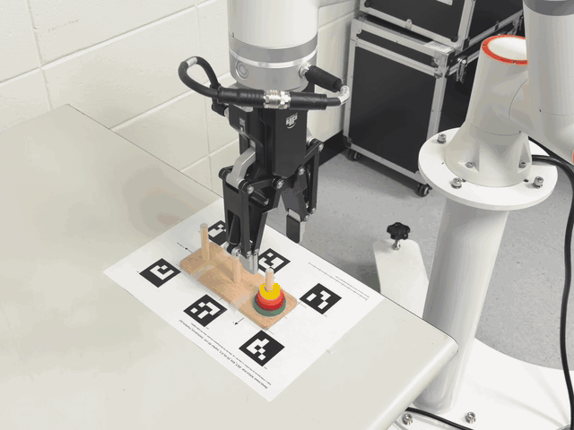
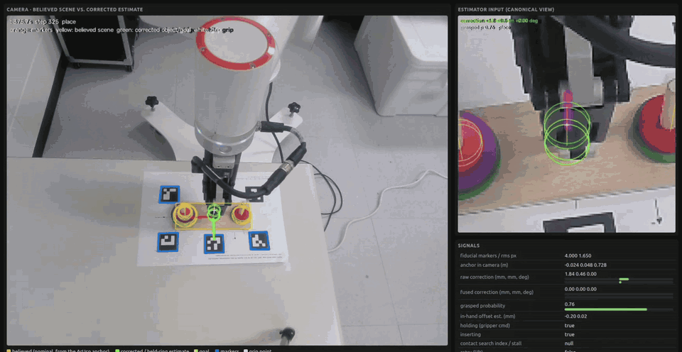
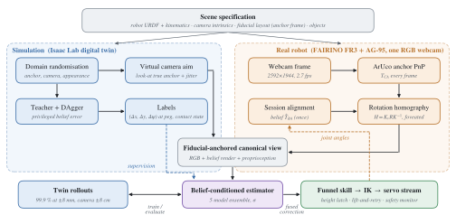
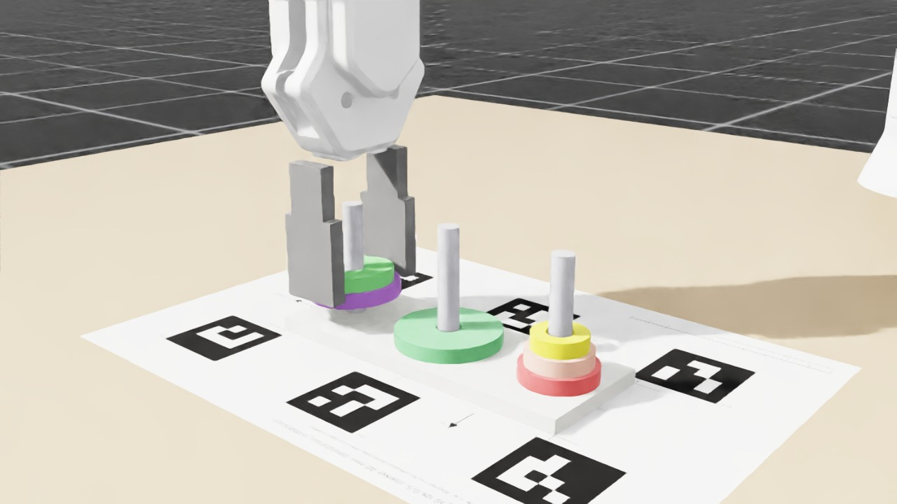
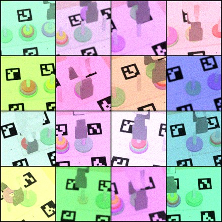
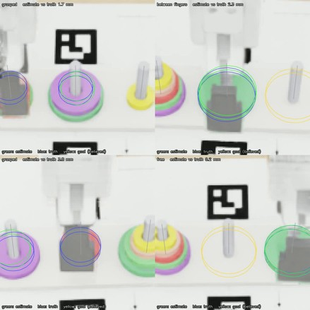
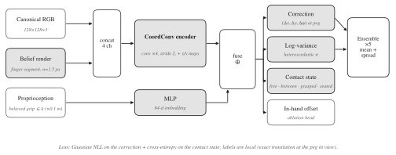
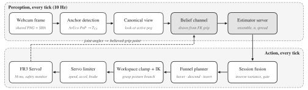

# FACTOR

**Fiducial-Anchored Canonical views for calibration-free Transfer Of precise Robot manipulation**

**English** · [한국어](README.ko.md)

Millimetre-precision pick-and-place from **one fixed third-person RGB camera**, trained entirely in
simulation. A fiducial mat on the table anchors the observations of the simulator and the real robot
to the same convention, so the camera can be moved without re-calibration.

## Real robot

<p align="center"></p>
<p align="center"></p>
<p align="center"><sub>FAIRINO FR3 + AG-95 on the ArUco mat (4×) · live view of the loop: believed vs. corrected scene,
the estimator's canonical view and its signals (2×)</sub></p>

<p align="center"></p>

## Idea

- **Fiducial-anchored canonical view.** A rotation homography about the detected ArUco mat turns any
  camera placement into the same virtual view. The Isaac Lab twin aims its camera the same way.
- **Belief as input.** The gripper pose the robot *believes* in is drawn into that view and also given as
  proprioception. The network reads the gap between the real fingers and the drawn belief and outputs
  the anchor correction.
- **Learn the residual, keep the rules.** Learning only says where the belief is wrong. A rule-based funnel
  planner with a height latch and lift-and-retry does the motion.

## Environment

<p align="center"></p>
<p align="center">
  
  
</p>
<p align="center"><sub>FACTOR twin in Isaac Lab (FR3 + AG-95, Tower of Hanoi on the ArUco mat) · canonical views under camera,
aim and appearance randomisation · occlusion: estimated ring outline vs. truth while the gripper hides the ring</sub></p>

## Architecture

<p align="center"></p>
<p align="center"></p>

## Results

| Setting | Result |
|---|---|
| Twin, anchor error ±8 mm, camera moved ±8 cm | **99.9 %** success (1,453 episodes), rules only 69.8 % |
| Ablation, three seeds | 98.4 % full, 89.1 % without the belief channel |
| Twin, camera moved ±12 cm, anchor error ±6 mm | 99.7 % |
| Active self-calibration (synthetic, 60 s) | 0.23 mm peg-point error |
| FAIRINO FR3, consecutive moves | 11 / 11 seated, 65 s per move |

On real frames the learned correction still shows an appearance gap; the robot runs used the
geometric mode. Details: [docs/SIM2REAL.md](docs/SIM2REAL.md), all runs: [docs/RUNS.md](docs/RUNS.md).

**Paper:** arXiv link coming soon.

## Install

```
git clone https://github.com/sxngt/factor && cd factor
uv sync --extra dev --extra real --extra perception
uv run pytest -q
```

Isaac Lab (twin and training), ROS 2 (robot driver) and the FAIRINO SDK are installed separately;
see [docs/ASSETS.md](docs/ASSETS.md) for the simulation assets.

## Usage

```
# simulation: train and evaluate the estimator (inside the Isaac Lab Python)
python -m factor.perception.train --scene configs/hanoi.yaml --assets <root> --out estimator.pt --headless
python -m factor.sim.isaaclab.check --scene configs/hanoi.yaml --assets <root> --checkpoint estimator.pt --headless

# robot: driver, camera, viewer and the closed loop in one script
export ROBOT_IP=192.168.58.2 CHECKPOINT=estimator.pt TORCH_PYTHON=/path/to/python-with-torch
scripts/run_real.sh --fake            # no motion
scripts/run_real.sh --moves 1         # one move
```

Full install and run guide: [docs/USAGE.md](docs/USAGE.md). Design notes: [docs/ARCHITECTURE.md](docs/ARCHITECTURE.md).

## Citing

```bibtex
@software{factor2026,
  author = {sxngt},
  title  = {{FACTOR}: Fiducial-Anchored Canonical views for calibration-free Transfer Of precise Robot manipulation},
  year   = {2026},
  url    = {https://github.com/sxngt/factor}
}
```

MIT license. Vendor meshes and SDKs keep their own licenses.
