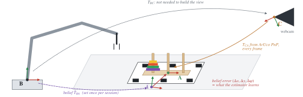
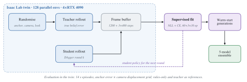
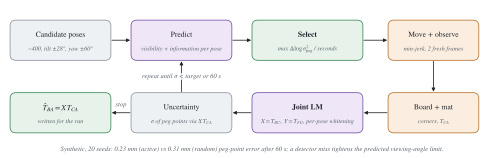

# FACTOR

**Fiducial-Anchored Canonical views for calibration-free Transfer Of precise Robot manipulation**

FACTOR is a hybrid learning architecture for millimetre-precision pick-and-place with a single
fixed RGB camera. It separates the problem into three layers:

| Layer | Responsibility | Learning |
|-------|----------------|----------|
| Perception | Fiducial-anchored canonical views, kinematic (URDF) render channels, model-based estimation of occluded object state | Supervised, labels from the simulation twin |
| Skills | Pick / insert micro-motions, search on contact, grasp and release timing | Rule-based initialisation, reinforcement-learning fine-tuning in a contact simulation |
| Task | Scene specification, symbolic planning (what goes where) | Task plugin, e.g. Tower of Hanoi |

The Tower of Hanoi task is the reference example; the layers below the task plugin are
object-agnostic and are configured from a scene specification (CAD / URDF, fiducial layout,
cameras). The reference hardware is a FAIRINO FR3 arm with a DH-Robotics AG-95 gripper and a
fixed USB webcam.

FACTOR 는 고정된 일반 RGB 카메라 한 대로 mm 급 픽앤플레이스를 수행하기 위한 하이브리드 학습
아키텍처입니다. 인식(지도학습)·스킬(규칙 초기화 + 강화학습 미세조정)·태스크(플러그인)의 세 층으로
나뉘며, 하노이 탑은 첫 번째 예시 태스크일 뿐입니다. 태스크 아래 층은 물체와 무관하고 장면 명세
(CAD/URDF, 피듀셜 배치, 카메라)로 구성됩니다. 기준 하드웨어는 FAIRINO FR3 + DH AG-95 + 고정 웹캠입니다.

<p align="center">
  
</p>

## How it works / 동작 원리

**Frames.** The camera finds the fiducial mat in every frame (`T_CA`). The robot only has to hold a
belief of the anchor in its own base (`T̂_BA`); the estimator learns the error of that belief. The
camera-to-robot transform `T_BC` is never needed to build the view, so the camera can be moved.
카메라는 매 프레임 매트를 찾고(`T_CA`), 로봇은 자기 베이스 기준 앵커의 믿음(`T̂_BA`)만 가지며, 추정기는
그 믿음의 오차를 배운다. 시야를 만드는 데 카메라-로봇 변환은 필요 없어 카메라를 옮겨도 된다.

<p align="center"></p>

**Estimator.** The canonical RGB view is stacked with a *belief render channel*, the finger segment
the robot believes in drawn into the same view, and the believed grip point enters as
proprioception. Removing the belief channel drops twin success from 98.4 % to 89.1 % (three seeds).
정규화 시야에 로봇이 믿는 핑거 선분을 그린 믿음 렌더 채널을 쌓고, 믿는 그립점을 고유수용 입력으로 준다.

<p align="center"></p>

**Training.** Teacher rollouts with the true belief error fill a frame buffer; DAgger rounds add the
student's own states; warm-start generations are averaged into a five-model ensemble.
교사 롤아웃 → 프레임 버퍼 → 지도 학습 → DAgger 라운드 → 웜 스타트 세대 → 5-모델 앙상블.

<p align="center"></p>

**On the robot.** Every tick: frame → anchor detection → canonical view with the belief channel →
estimator → session fusion → funnel planner → clamp and IK → speed-, acceleration- and
brake-limited servo stream with a safety monitor.
실기에서는 매 틱 인식(위)과 행동(아래)이 돌며, 관절각이 다시 믿음 채널로 들어간다.

<p align="center"></p>

**Session self-calibration.** With a small ArUco board on the gripper, the robot picks its own poses
for about a minute: predict which pose shrinks the peg-point uncertainty fastest, move, observe,
re-solve camera-in-base and board-on-flange jointly, repeat.
그리퍼 보드로 1분 안에 능동적으로 자세를 골라 카메라-베이스를 풀고 앵커를 로봇 좌표로 옮긴다.

<p align="center"></p>

Figures are generated by `docs/figures/make_figures.py` (PDF for papers, SVG and PNG for the web).
그림은 `docs/figures/make_figures.py` 로 다시 만들 수 있다(논문용 PDF, 웹용 SVG·PNG).

## Install / 설치

FACTOR is a [uv](https://docs.astral.sh/uv/) project (Python 3.10–3.12).

```
git clone https://github.com/sxngt/factor && cd factor
uv sync --extra dev                  # core (numpy, pyyaml) + pytest, ruff
uv sync --extra dev --extra real     # + OpenCV, Pillow (camera, fiducials, real loop)
uv sync --extra perception           # + PyTorch (estimator training and serving)
uv run pytest -q
```

Three dependencies cannot come from PyPI:

* **Isaac Lab** (simulation twin, training): install it following its documentation and install
  FACTOR into its Python (`python -m pip install -e .`).
* **ROS 2** (robot driver and the real loop): `rclpy`, `sensor_msgs`, `std_srvs`,
  `control_msgs`, `rcl_interfaces` come from the ROS 2 install (Humble tested); source its
  setup file. The `ros` extra only documents this.
* **FAIRINO SDK** (`fairino` package, FAIRINO's `fairino-python-sdk`) at the tag that matches
  the controller firmware (tested: SDK v2.1.6, firmware v3.8.6). Only the real driver and the
  `factor-fr3-*` tools import it; `factor-fr3-driver --fake` runs without it.

## Quick start in simulation / 시뮬레이션 빠른 시작

The twin needs the robot, ring and mat USD files; [docs/ASSETS.md](docs/ASSETS.md) explains
what they are and how to build them from the vendor descriptions. With an assets root `<root>`
(the directory containing `assets/usd/...`), inside the Isaac Lab Python:

```
# teacher smoke test: success close to 100 %
python -m factor.sim.isaaclab.check --scene configs/hanoi.yaml --assets <root> --num_envs 32 --headless

# train the state estimator on twin frames (teacher collection + DAgger rounds)
python -m factor.perception.train --scene configs/hanoi.yaml --assets <root> \
    --num_envs 96 --steps 1000 --dagger_rounds 2 --out estimator.pt --headless

# evaluate it in the twin
python -m factor.sim.isaaclab.check --scene configs/hanoi.yaml --assets <root> \
    --checkpoint estimator.pt --num_envs 32 --headless
```

Training recipes and results of every run: [docs/RUNS.md](docs/RUNS.md).

## Quick start on the robot / 실기 빠른 시작

Processes on the robot PC (all package entry points):

| entry point | role |
|-------------|------|
| `factor-fr3-driver` | ROS 2 driver: `/joint_states`, servo stream on `/fr/servo_target` (speed, acceleration and braking limited), safety monitor, AG-95 gripper action |
| `factor-camera` | owns the webcam, writes `latest_color.png` + `latest.json` atomically |
| `factor-run` | the closed loop: fiducials → canonical view → estimator → planner → servo targets |
| `factor-serve` | estimator server in a PyTorch Python, started by `factor-run` |
| `factor-selfcalib` | one-minute active self-calibration of the anchor pose |
| `factor-view` | live telemetry viewer (browser) |
| `factor-record` | mp4 of the shared camera frames |
| `factor-fr3-power`, `factor-fr3-check`, `factor-fr3-probe` | controller mode / reset, preflight, servo-stream probe |

`scripts/run_real.sh` runs the whole chain (controller reset and AUTO, preflight, driver with the
servo parameters, servo probe, camera, viewer, optional self-calibration, recorder, loop):

```
source /opt/ros/humble/setup.bash
export ROBOT_IP=192.168.58.2 CHECKPOINT=estimator.pt TORCH_PYTHON=/path/to/python-with-torch
scripts/run_real.sh --fake                                    # no motion: loop, camera, estimator, viewer
scripts/run_real.sh --moves 1 --step-scale 0.2 -- --no-correction   # one slow move on nominal geometry
scripts/run_real.sh --self-calib --moves 1                    # self-calibrate the anchor, then move
```

Recommended for first runs (from [docs/SIM2REAL.md](docs/SIM2REAL.md)): `--fake` first, then
single moves at reduced speed (`--moves 1 --step-scale 0.2`). The estimator's real-frame outputs
(correction and grasp verdict) are not yet trustworthy, so `-- --no-correction` is the safe
setting until the appearance gap is closed; grasp verification is off unless `--verify-grasp`.
Viewer at `http://localhost:8780`, videos in `logs/factor/videos/`. Run `scripts/run_real.sh --help`
for the environment variables (camera device, intrinsics, log directories, servo parameters).

The driver never moves the arm on its own: motion happens only inside a servo session, which
starts only in AUTO mode without errors or safety stops, ends when targets stop arriving, and is
stopped by the safety monitor on controller flags, tracking deviation or torque jumps.
드라이버는 스스로 팔을 움직이지 않는다: 서보 세션 안에서만 움직이며, 세션은 AUTO·에러 없음·안전정지
없음에서만 시작하고 목표가 끊기면 끝나며, 안전 감시가 제어기 플래그·추종 편차·토크 급변에서 멈춘다.

## Layout / 구성

```
src/factor/
  scene/          scene specification (objects, fiducials, cameras, robot)       장면 명세
  perception/     canonical views, fusion, estimator networks, training, server  인식
  planning/       funnel motion planner, contact search (nudge), task planner     계획
  skills/         pick / place skills, residual RL policy                         스킬
  calib/          active self-calibration (gripper board, hand-eye)                자기보정
  sim/isaaclab/   simulation twin (Isaac Lab, optional)                           시뮬 트윈
  real/           real loop, safety box, telemetry, viewer, camera server         실기
  robots/fr3/     FR3 kinematics, ROS 2 adapter and driver, SDK, safety, tools   FR3
  tasks/hanoi/    Tower of Hanoi plugin                                           태스크 플러그인
configs/          reference scene and gripper board
assets/urdf/      FR3 + AG-95 URDF (meshes via package://, see docs/ASSETS.md)
scripts/          run_real.sh
tests/            unit tests (no GPU, no ROS, no robot)
docs/             architecture, sim-to-real log, run registry, assets
```

## Documentation / 문서

* [docs/ARCHITECTURE.md](docs/ARCHITECTURE.md): the layers, the twin and the simulation results.
* [docs/SIM2REAL.md](docs/SIM2REAL.md): what broke on the robot and what changed; pre-run checklist.
* [docs/RUNS.md](docs/RUNS.md): every training run and its artefacts.
* [docs/ASSETS.md](docs/ASSETS.md): simulation assets.
* [CONTRIBUTING.md](CONTRIBUTING.md): development workflow.

## Status / 상태

Pre-alpha, but end to end: scene specification, Isaac Lab twin, supervised estimator training
with DAgger, fiducial detection, estimator server, active self-calibration, the FR3 ROS 2 driver
and the `factor-run` loop. First real moves on the FR3 are logged in `docs/SIM2REAL.md`.

## Citing / 인용

If you use FACTOR, please cite:

```bibtex
@software{factor2026,
  author = {sxngt},
  title  = {{FACTOR}: Fiducial-Anchored Canonical views for calibration-free Transfer Of precise Robot manipulation},
  year   = {2026},
  url    = {https://github.com/sxngt/factor}
}
```

## License

MIT (see `LICENSE`). Vendor meshes and SDKs referenced here keep their own licenses.
